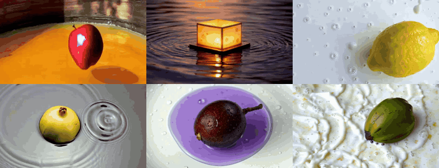
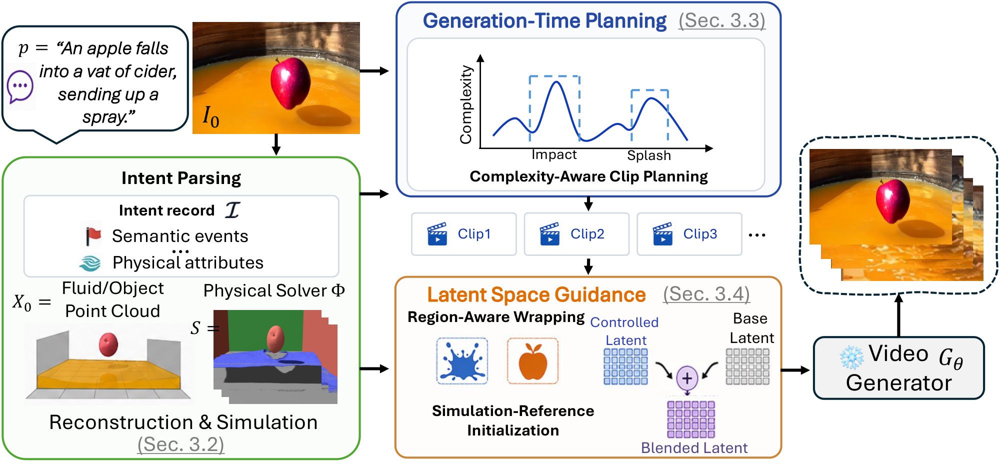

<div align="center">

# 🌊 Fluid-Gen-Zero

### Grounding Pretrained Video Generators in Physics without Training

[Hong Huang](https://hongh0.github.io/)<sup>1</sup>,
[Yuqiu Liu](https://autumnyq.github.io/)<sup>1</sup>,
[Chenyu You](https://chenyuyou.me/)<sup>2</sup>,
[Daniel F Martin](https://scholar.google.com/citations?user=oXfed6oAAAAJ&hl=en)<sup>3</sup>,
[Chuhang Zou](https://zouchuhang.github.io/)<sup>4†</sup>,
[Wuyang Chen](https://chenwydj.github.io/)<sup>1†</sup>

<sup>1</sup>Simon Fraser University &nbsp;
<sup>2</sup>Stony Brook University &nbsp;
<sup>3</sup>Lawrence Berkeley National Laboratory &nbsp;
<sup>4</sup>Meta Reality Labs
<br>
<sup>†</sup>Corresponding authors

<a href="https://arxiv.org/abs/2610.10984"></a>
<a href="https://hongh0.github.io/Fluid-Gen-Zero/"></a>
<a href="https://huggingface.co/datasets/hhkka/FluidGen-Benchmark"></a>
<a href="LICENSE"></a>



</div>

**Fluid-Gen-Zero** is a training-free framework for physics-aware fluid-object
interaction video generation. A physics simulator decides *what moves and when*;
a frozen, pretrained video generator decides *how it looks*. The two are coupled
purely at inference time through generation-time planning and latent-space
guidance, so the same code drives **WanMove**, **VACE** and **Tora** without
updating a single weight.

<p align="center"></p>

## 📢 News

- **[2026.10]** Paper released on [arXiv](https://arxiv.org/abs/2610.10984).
- **[2026.10]** Code released.
- **[2026.10]** FluidGen Benchmark released on 🤗 [Hugging Face](https://huggingface.co/datasets/hhkka/FluidGen-Benchmark).

## 🛠️ Installation

```bash
git clone https://github.com/hongh0/Fluid-Gen-Zero.git
cd Fluid-Gen-Zero
cp env.example.sh env.sh && source env.sh   # edit paths first

# main environment: reconstruction, simulation, planning
conda create -n fluidgen python=3.10 -y && conda activate fluidgen
#   install torch 2.4 / pytorch3d / kaolin for your CUDA and
#   SAM 3D Objects (third_party/sam-3d-objects) following their READMEs, then
pip install -r requirements.txt

# video backbones: clone upstream at our pinned commits and apply our changes
bash backbones/setup.sh                     # -> third_party/{Wan-Move,VACE,Tora}
```

Create the `wan` environment and download the weights following
[Wan-Move](https://github.com/ali-vilab/Wan-Move) (and, optionally,
[VACE](https://github.com/ali-vilab/VACE) / [Tora](https://github.com/alibaba/Tora)
with a `tora` environment).

<details>
<summary><b>Checkpoints for reconstruction</b></summary>

Put these under `checkpoints/`, or point the variables in `env.sh` at them.

| path | source |
|---|---|
| `sam2.1_hiera_large.pt` | [facebook/sam2.1-hiera-large](https://huggingface.co/facebook/sam2.1-hiera-large) |
| `grounding-dino-base/` | [IDEA-Research/grounding-dino-base](https://huggingface.co/IDEA-Research/grounding-dino-base) |
| `moge-2-vitl/model.pt` | [Ruicheng/moge-2-vitl](https://huggingface.co/Ruicheng/moge-2-vitl) |
| `sam-3d-objects/` | [facebook/sam-3d-objects](https://huggingface.co/facebook/sam-3d-objects), then `python scripts/setup/prepare_sam3d_moge2.py <sam-3d-objects>/checkpoints` |
| `FLUX.1-dev/` | [black-forest-labs/FLUX.1-dev](https://huggingface.co/black-forest-labs/FLUX.1-dev) |
| `FLUX.1-dev-Controlnet-Inpainting-Beta/` | [alimama-creative/FLUX.1-dev-Controlnet-Inpainting-Beta](https://huggingface.co/alimama-creative/FLUX.1-dev-Controlnet-Inpainting-Beta) |
| `owlv2-base-patch16-ensemble/`, `clipseg-rd64-refined/`, `groundingdino/` | segmentation fallbacks: [OWLv2](https://huggingface.co/google/owlv2-base-patch16-ensemble), [CLIPSeg](https://huggingface.co/CIDAS/clipseg-rd64-refined), [GroundingDINO SwinT-OGC](https://github.com/IDEA-Research/GroundingDINO) |

</details>

## 🚀 Quick Start

Fluid-Gen-Zero uses a VLM for intent parsing, clip planning and clip-level
prompts, so an OpenAI API key is required (the model can be changed with
`FGZ_VLM_MODEL`):

```bash
export OPENAI_API_KEY=sk-...
bash scripts/run_sample.sh apple examples/apple.png \
    "An apple falls into a vat of cider, sending up a spray."
```

The video is written to `runs/apple/wanmove/gen/`. Pass `"wanmove vace tora"`
as a fourth argument to also run VACE and Tora, and set `FGZ_NUM_FRAMES` to
change the rollout length (default 401).

## 📦 FluidGen Benchmark

43 fluid-object interaction scenes across 10 fluid categories, each with an
input image, a prompt and its simulation rollout (3D particle trajectories,
object and fluid masks, optical flow), on
🤗 [Hugging Face](https://huggingface.co/datasets/hhkka/FluidGen-Benchmark):

```bash
huggingface-cli download hhkka/FluidGen-Benchmark --repo-type dataset --local-dir FluidGen_Benchmark
```

## 📄 License

This project is released under the [Apache-2.0 License](LICENSE). The upstream
backbones and models it builds on keep their own licenses.

## 🙏 Acknowledgements

Fluid-Gen-Zero builds on [Wan-Move](https://github.com/ali-vilab/Wan-Move),
[VACE](https://github.com/ali-vilab/VACE), [Tora](https://github.com/alibaba/Tora),
[Time-to-Move](https://github.com/time-to-move/TTM), [SDEdit](https://github.com/ermongroup/SDEdit),
[Genesis](https://github.com/Genesis-Embodied-AI/Genesis), [SAM 2](https://github.com/facebookresearch/sam2),
[Grounding DINO](https://github.com/IDEA-Research/GroundingDINO), [MoGe](https://github.com/microsoft/MoGe),
[SAM 3D Objects](https://github.com/facebookresearch/sam-3d-objects) and
[FLUX ControlNet Inpainting](https://github.com/alimama-creative/FLUX-Controlnet-Inpainting).
We thank the authors for releasing their code and models.

## 📝 Citation

If you find this work useful, please cite:

```bibtex
@article{fluidgenzero2026,
  title   = {Fluid-Gen-Zero: Grounding Pretrained Video Generators in Physics without Training},
  author  = {Huang, Hong and Liu, Yuqiu and You, Chenyu and Martin, Daniel and Zou, Chuhang and Chen, Wuyang},
  journal = {arXiv preprint arXiv:2610.10984},
  year    = {2026},
}
```
